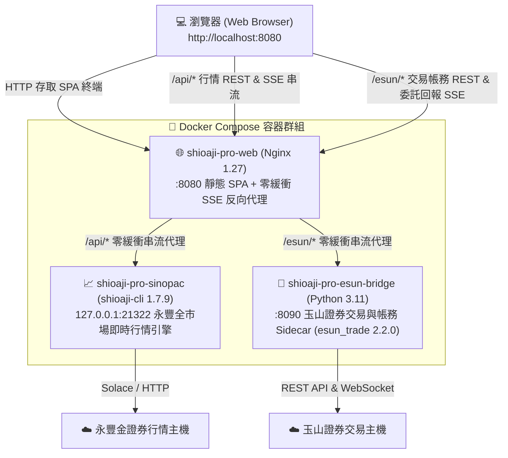

# Shioaji Esun Pro — 雙券商專業交易終端 Trading Terminal

**[專案首頁 / GitHub](https://github.com/Yuno-Liu/shioaji-esun-pro)** ・
**[原版 Shioaji Pro 官網](https://sinotrade.github.io/shioaji-pro-app/)**

專為台灣市場（上市／上櫃／期交所）打造的雙券商專業交易終端，整合 **永豐金證券 Shioaji API 即時行情數據** 與 **玉山證券 API（`esun_trade 2.2.0`）下單與帳務**，並支援永豐金證券交易與雙券商動態切換。前端基於 React 19 + TypeScript + Vite，後端支援 Docker 網頁版三容器一鍵部署與桌面版。

以 Shioaji 即時行情與玉山交易 API 打造的專業終端：全市場即時行情、K 線、五檔、閃電下單、圖表點價下單、停損停利觸價單、圖表畫圖工具、雙券商帳務管理與可自由拖曳排版的自訂版面。

**支援雙券商並行架構** — 預設以永豐金證券提供全市場即時行情串流（免費模擬模式即可接收完整盤中真實行情），由玉山證券正式環境負責股票委託下單、改價、改量、刪單、持股庫存、交割款與損益計算。


## Live Market Intelligence 即時市場情報

Shioaji 1.7.1 的即時計算指數、成分股與產業貢獻，現在整合成可自由配置的
市場脈動面板。自算指數會同時對照官方指數、更新時間差、台指近月與期現差；
成分股貢獻、產業分布和貢獻傳導可單獨或並排顯示。


盤中雷達接收上市與上櫃即時訊號，能依訊號自動連動 K 線、五檔和成交明細。
市場與訊號規則皆可細項多選，設定區可隨時收合。

| 盤中雷達 | 訊號與市場篩選 |
|---|---|
|  |  |

## Features 功能

- **即時行情** — 單一 SSE 連線串流 tick / 五檔，自選清單成交閃動（只在真實成交時閃，試撮不閃）
- **K 線圖** — lightweight-charts，1m/5m/15m/60m/1D，即時 tick 更新當根 K 棒，
  **歷史無限回溯**（往左拖自動載入更舊 K 棒，最多三年）
  - **交易模式 / 畫圖模式**：頂端工具列武裝交易（點價買賣、停損、停利、警示），
    左側工具列負責畫圖與瀏覽，一次只有一種模式生效
  - **點價下單**：點圖表價位直接限價買賣
  - **停損 / 停利**：在圖上掛觸價單（觸價送市價單），虛線顯示、可取消
  - **委託管理**：未成交委託顯示為實線、overlay 有 CANCEL 按鈕、**拖曳委託線即改價**
  - **畫圖工具**：水平線／趨勢線／射線／延伸線／方框，TradingView 式色盤、
    線寬與虛實線、鎖定／隱藏／複製；水平線可輸入精確價位。依商品保存、
    切換週期不跑位（期貨連續月與月份合約預設共用，可關閉）
  - **Hover 同步**：十字線價位即時同步到下單面板
- **閃電下單** — 價格梯點擊即下單（左欄買/右欄賣），含安全開關；
  **⚡全開**：自選前 N 檔自動平鋪多個閃電面板（可選排版）
- **鋪單面板** — 一鍵多檔位掛單：靜態鋪單 ＋ 動態追價模式
- **五檔報價** — 量能條視覺化，點價帶入下單面板
- **成交明細** — 開啟即載入歷史 tick，時間精確到微秒
- **下單面板** — 整股/零股、ROD/IOC/FOK、期貨倉別、沖賣 daytrade_short，
  兩段式確認防誤觸
- **組合單** — 期貨/選擇權組合單（價差、跨式…），T 字報價點擊連動兩腳、
  到價監控自動送單
- **持倉 / 委託 / 帳務** — 即時損益、刪單改量、權益數與保證金、
  資產市值加總＋分布圖、零股混合單位顯示（X張+Y股）
- **排行榜** — 漲幅 / 量 / 額多條件複選 scanner（含放空篩選）、顯示類別、
  點擊即加入追蹤
- **產業全景** — 產業 treemap（面積＝成交值/貢獻可切換、色＝加權漲跌幅）、
  加權/櫃買切換；點產業下鑽主力貢獻或成交值排行＋貢獻磚牆，
  「其他成員」漲跌幅由群組加權反推
- **交易安全** — 風控 Kill Switch（單筆上限/日虧上限/一鍵鎖單）、
  Esc×2 全部刪單、括號單（成交後自動掛 OCO 停損停利）、持倉一鍵平倉/反手、
  委託改量、下單預估成本（手續費/稅/契約值）
- **快捷鍵** — B/S 切換買賣、Esc×2 全刪單、⌘K 商品搜尋跳轉（支援中文股名）
- **技術指標** — 21 種內建（主圖均線/通道/SAR/SuperTrend，副圖 MACD/RSI/KD
  等震盪指標），TradingView 式選擇器與設定視窗（色盤/線型/時框顯示/
  我的預設），副圖獨立窗格、圖上 legend 即時數值
- **自訂指標** — 面板內用 JavaScript + `ta.*` 函式庫寫自己的指標
  （`plot()`/`hline()` 宣告輸出），Web Worker 沙箱驗證（自動擋無窮迴圈）、
  自動偵測輸出線，寫完與內建指標同等待遇（設定/樣式/收藏全套）
- **大盤狀態列** — 加權指數與台指期基差常駐頂部
- **市場脈動** — 自算指數對照官方指數、時間差與期現差，成分股貢獻與
  產業到主要個股的貢獻傳導可自由組合顯示（指數成分即時串流驅動）
- **盤中雷達** — 上市／上櫃即時訊號，規則與市場細項多選，訊號出現時可自動
  連動 K 線、五檔與成交明細
- **到價警示** — 圖上點擊設警示線（只通知不下單），音效＋toast
- **分析面板** — 損益分析（權益曲線/勝率/賺賠比）、分價量表＋內外盤比、
  個股籌碼卡（融資券/借券/處置股）、選擇權 T 字報價（TXO）、
  選擇權損益圖（買方/賣方到期損益）
- **行情回放** — 重播當日歷史 tick 練盤感（1x–100x 變速）
- **委託簿熱圖** — 五檔掛單牆的時間序列視覺化
- **自選清單** — 漲跌幅排序、列備註、迷你走勢圖（可開關）、拖曳排序
- **自訂版面** — react-grid-layout 拖拉移動/縮放，面板可任意新增（多開 K 線圖）、
  每個面板可「連動自選」或「鎖定商品」、可彈出成獨立視窗（多螢幕）、
  版面可命名儲存/載入，內建多組預設版面
- **通知中心 / 診斷面板** — 委託回報時間軸、系統事件、App 版本與連線診斷
- **隱私模式** — 一鍵遮蔽帳號與金額（demo / 截圖 / 直播用）
- **音效回報** — 成交/委託/警示分音色（可關閉）
- **斷線自癒** — SSE 重連後自動重新訂閱所有商品；斷線時自動鎖定下單按鍵
- **主題** — 深色 / 純黑 / 淺色 × 紅漲綠跌(台式) / 綠漲紅跌(美式)，字級可調

| Dark | Light |
|------|-------|
|  |  |

## Desktop App 桌面版（推薦）

到 [Releases](https://github.com/Sinotrade/shioaji-pro-app/releases) 下載對應平台安裝檔
（macOS `.dmg`、Windows `.msi`、Linux `.AppImage`/`.deb`/`.rpm`）。桌面版特色：

系統需求：macOS 13.3+（Apple Silicon / Intel）、Windows 10/11 x64、Linux x86_64。

- **AI Agent** — 多供應商（Claude / Codex）agentic 對話、shioaji 技能市集、
  排程任務、操作觀察學習（桌面版專屬）
- **Codex 訂閱免手動裝 CLI** — 安裝新版 ChatGPT Desktop 並登入 ChatGPT，
  AI Agent 設定頁會偵測 App 內建 Codex runtime、檢查登入與官方 skill；
  也可繼續使用獨立安裝的 Codex CLI（舊版 ChatGPT Classic 不含 Codex）
- **策略回測** — 用 JS 寫進出場策略（與自訂指標同一套 `ta` 函式庫）、
  含手續費/證交稅/期交稅/滑價的回測引擎（訊號收盤成立、次根開盤成交，
  無未來函數）、單商品與自選清單多商品整合績效（合併權益曲線＋可排序
  商品表）、進出場標記直接畫在 K 線上（桌面版專屬）
- **內建 shioaji server**（sidecar）— 不需另外安裝 CLI
- **伺服器管理介面** — header「伺服器」選單：啟動/停止/重啟、健康狀態、
  PID/port、token 效期；API 金鑰在介面填寫（存於本機 App 資料夾）
- **模擬/正式環境切換** — 介面上切換，重啟伺服器生效
- **系統匣（Menu Bar）** — 關閉視窗縮到系統匣常駐；匣選單可叫回視窗、
  開伺服器管理、檢查更新
- **自動更新** — 啟動時靜默檢查，GitHub Releases 簽章驗證後自動更新重啟
- **多視窗 Popout** — 面板 ⧉ 彈出為原生視窗，多螢幕交易
- **單一實例** — 重複開啟自動聚焦既有視窗

> 桌面版外殼（Tauri）、AI Agent 與策略回測為專屬模組，不在本 repo ——
> 本 repo 可 build 出完整的 Web 版終端（CI 持續驗證），桌面版請直接下載安裝檔。

## Getting Started 開始使用（Web 版）

### 1. Prerequisites 前置需求

- 永豐金證券帳戶 + Shioaji API Key/Secret
  （在 [API 管理頁](https://www.sinotrade.com.tw/newweb/PythonAPIKey/) 建立）
- [Node.js](https://nodejs.org/) 20+ 與 [pnpm](https://pnpm.io/)
- Shioaji CLI：

```sh
# 推薦用 uv 安裝
uv tool install shioaji-cli
# 或下載 standalone binary，見 https://sinotrade.github.io/
```

CLI 由獨立的 `shioaji-cli` 套件提供，指令名稱仍是 `shioaji`；Python 3.14t 的
`shioaji` wheel 不含 CLI。桌面版已內建 standalone binary，不需另外安裝。

### 2. Configure credentials 設定金鑰

```sh
cp .env.example .env
# 編輯 .env，填入你的 SJ_API_KEY / SJ_SEC_KEY
```

> `.env` 已被 `.gitignore` 排除，**請勿** commit 你的金鑰。

### 3. Start the Shioaji server 啟動行情/交易伺服器

```sh
shioaji server start          # 預設模擬環境（紙上交易）
shioaji server check          # 確認狀態
```

預設跑在 `http://127.0.0.1:8080`，**simulation 模式**——下單不會動用真錢。
切正式環境：`shioaji server start --production`（需先完成 CA 憑證設定，
請務必先在模擬環境完整測試）。

### 4. Run the app 啟動前端

```sh
pnpm install
pnpm dev
```

開啟 [http://localhost:5173](http://localhost:5173) —— dev server 會把
`/api` 代理到 `localhost:8080`。

## 🐳 一鍵部署 Docker 網頁版（永豐即時行情 ＋ 玉山／永豐雙券商交易並行）

本專案支援以 Docker 容器化技術一鍵部署專業 Web 交易終端，預設採用 **「永豐證券取得即時行情數據 ＋ 玉山證券負責委託下單與帳務」** 雙引擎並行架構，亦可隨時於介面切換玉山或永豐帳號。

### 1. 三容器全自動並行架構



- **`shioaji-pro-web`（Nginx Web 終端與反向代理）**：基於 `nginx:1.27-alpine`，託管編譯後的 Vite SPA 終端（含 `/index.html` 與獨立確認視窗 `/approval.html`）。針對 `/api/` 與 `/esun/` 均啟用零緩衝 SSE 串流設定（`proxy_buffering off; proxy_cache off; proxy_next_upstream off;`），確保行情與委託回報零延遲且絕不自動重送非冪等下單請求。
- **`shioaji-pro-sinopac`（服務名 `shioaji-server`，永豐金即時行情容器）**：內建 `shioaji-cli==1.7.9`，共享 Web 容器網路命名空間（`127.0.0.1:21322`），自動讀取 `.env` 中的 `SJ_API_KEY` 與 `SJ_SEC_KEY` 啟動，提供全市場台股、期貨與選擇權的即時 Tick、五檔、K 線、合約與快照數據（無須在宿主機手動安裝 Python 或 CLI）。
- **`shioaji-pro-esun-bridge`（服務名 `esun-bridge`，玉山證券交易與帳務容器）**：基於 `python:3.11-slim`，內建玉山證券官方 Linux SDK（`esun_trade-2.2.0-linux.whl`），提供股票委託下單、改價、減量、刪單、庫存、銀行餘額、T+2 交割款、歷史已實現損益查詢，以及單例 WebSocket 轉 `/esun/stream/orders` SSE 即時回報推播。

---

### 2. 前置準備（三步驟完成設定）

#### 步驟 1：放入憑證檔案（`./certs/`）
在專案根目錄建立 `./certs/` 資料夾（首次執行一鍵部署腳本亦會自動建立），將玉山證券核發之 `.p12` 憑證檔案放入其中：
```text
./certs/esun_cert.p12
```
> 💡 若您同時有使用永豐證券帳號下單的需求，亦可將永豐憑證（如 `Sinopac.pfx`）一併放入 `./certs/` 目錄中。

#### 步驟 2：設定玉山證券設定檔（雙環境切換或單一設定檔）
系統支援**測試與正式雙環境設定檔（推薦）**，亦完全向下相容單一 `esun-config.ini`：

##### 模式 A：雙環境無縫切換（推薦）
在專案根目錄同時提供測試與正式設定檔，終端介面頂欄即可隨時自由切換；若僅提供其中一個檔案，前端會自動禁用未提供之模式並提示「未提供設定檔 (不可選)」：
- **測試／模擬環境**：複製 `esun-config.simulation.ini.example` 為 `esun-config.simulation.ini`（亦支援別名 `esun-config.sim.ini`）
- **正式交易環境**：複製 `esun-config.production.ini.example` 為 `esun-config.production.ini`（亦支援別名 `esun-config.prod.ini`）

```powershell
# Windows PowerShell
Copy-Item esun-config.simulation.ini.example esun-config.simulation.ini
Copy-Item esun-config.production.ini.example esun-config.production.ini

# Linux / macOS / Git Bash
cp esun-config.simulation.ini.example esun-config.simulation.ini
cp esun-config.production.ini.example esun-config.production.ini
```

##### 模式 B：單一通用設定檔向下相容
複製範本檔至專案根目錄 `./esun-config.ini`：
```powershell
# Windows PowerShell
Copy-Item esun-config.ini.example esun-config.ini

# Linux / macOS / Git Bash
cp esun-config.ini.example esun-config.ini
```
編輯設定檔並填入玉山證券 API 管理頁面核發之參數：
```ini
[Core]
# 正式環境規範：Entry = https://esuntradingapi.esunsec.com.tw/api/v1 (不設 Environment 欄位)
# 測試環境規範：Entry = https://esuntradingapi-simulation.esunsec.com.tw/api/v1 且 Environment = SIMULATION
Entry = https://esuntradingapi.esunsec.com.tw/api/v1

[Cert]
Path = ./certs/esun_cert.p12

[Api]
Key = 您的玉山_API_KEY
Secret = 您的玉山_API_SECRET

[User]
# 支援 11 碼（前 4 碼分公司代碼 + 7 碼帳號，如 88400664718）或 7 碼帳號
Account = 8840您的7碼帳號
```

#### 步驟 3：設定 `.env`（永豐行情 API Key ＋ 玉山登入／憑證密碼）
複製 `.env.docker.example` 為 `.env`：
```powershell
# Windows PowerShell
Copy-Item .env.docker.example .env

# Linux / macOS / Git Bash
cp .env.docker.example .env
```
編輯 `.env`，填入 **玉山證券密碼** 與 **永豐證券 API Key**：
```dotenv
# ── 1. 玉山證券密碼（負責股票正式下單與帳務） ─────────────────────────
# 注意：登入密碼輸錯滿 3 次將觸發玉山官方鎖帳 (AGA0000)，本系統已內建單次熔斷保護
ESUN_ACCOUNT_PASSWORD=您的玉山證券登入密碼
ESUN_CERT_PASSWORD=您的玉山憑證密碼

# ── 2. 永豐金證券 API 金鑰（負責全市場即時行情數據） ──────────────────
# 申請網址：https://www.sinotrade.com.tw/newweb/PythonAPIKey/
SJ_API_KEY=您的永豐_API_KEY
SJ_SEC_KEY=您的永豐_SECRET_KEY

# 建議維持 false（使用永豐模擬模式即可免永豐憑證、免費取得完整盤中即時行情，並由玉山負責真實下單）
SJ_PRODUCTION=false

# （選填）若亦需使用永豐證券帳號下單，請將永豐 .pfx 放入 ./certs/ 並填寫：
# SJ_CA_PATH=/app/certs/Sinopac.pfx
# SJ_CA_PASSWD=您的永豐憑證密碼

# ── 3. 連接埠與上游設定（預設無須修改） ───────────────────────────────
WEB_PORT=8080
PORT=8080
BRIDGE_PORT=8090
SHIOAJI_API_UPSTREAM=http://127.0.0.1:21322
ESUN_BRIDGE_UPSTREAM=http://esun-bridge:8090
```

> [!IMPORTANT]
> `.env`、`esun-config.ini` 與 `certs/` 均已列於 `.gitignore` 與 `.dockerignore` 中，不會被提交至 Git 或打包進映像檔層，僅在容器啟動時以唯讀掛載或環境變數注入。

---

### 3. 一鍵啟動與操作方式

執行一鍵部署指令後，Docker 會自動同時建置並啟動 **Web 前端 (`shioaji-pro-web`)**、**永豐即時行情 (`shioaji-pro-sinopac`)** 與 **玉山交易帳務 (`shioaji-pro-esun-bridge`)** 三大容器：

#### 方式 A：使用一鍵部署腳本（推薦）
腳本會自動檢查 Docker 環境、初始化缺少的 `.env` / `esun-config.ini` / `certs/`，並自動建置與啟動所有容器：

- **Windows PowerShell**：
  ```powershell
  pnpm run docker:deploy
  # 或直接執行 PowerShell 腳本：
  .\scripts\deploy-docker.ps1 -Action up
  ```
  > 💡 **進階模式（Windows 宿主機原生 Bridge）**：若想在 Windows 本機直接跑 Python Sidecar 並讓容器代理連線，可加上 `-HostBridge`：
  > `.\scripts\deploy-docker.ps1 -Action up -HostBridge`

- **Linux / macOS / Git Bash**：
  ```bash
  ./scripts/deploy-docker.sh up
  ```

#### 方式 B：使用 Docker Compose 標準指令
```bash
docker compose up -d --build
```

啟動完成後，打開瀏覽器造訪：
👉 **[http://localhost:8080](http://localhost:8080)**

---

### 4. 「永豐取行情 ＋ 玉山負責下單」並行運作與雙券商切換說明

1. **預設自動鎖定玉山證券下單**：
   - 當玉山與永豐容器同時運行時，系統會自動將 **玉山證券帳號（`8840-xxxxxxx`）** 排在股票帳號第一順位並設為預設下單帳號。
   - 所有股票看盤報價（即時走勢、K 線、最佳五檔、分價量表、自選股報價）與玉山庫存持股的即時報價，皆自動由 **永豐 `shioaji-pro-sinopac`** 即時供應。
   - 所有股票交易與帳務操作（新單委託、改價、減量、刪單、當日委託回報、持股庫存、銀行餘額、T+2 交割款、歷史已實現損益），皆自動由 **玉山 `shioaji-pro-esun-bridge`** 執行。
2. **雙券商動態切換**：
   - 點擊右上角「設定 ➔ 帳號」或下單盒／底部帳務面板的帳號下拉選單，可隨時在 **玉山證券帳號** 與 **永豐金證券帳號** 之間切換。
3. **期貨與選擇權自動保護**：
   - 玉山證券 Python SDK（`esun_trade`）僅支援台股現貨（整股、盤中零股、盤後零股、定盤、興櫃）；當選擇玉山帳號嘗試送出期貨或選擇權委託時，系統會自動攔截並提示切換至永豐期貨帳號。

---

### 5. 玉山證券 API 官方使用限制與內建防護機制一覽表

本專案 Sidecar（[`server/esun_trade_server.py`](server/esun_trade_server.py)）與前端轉譯層（[`src/lib/esun/`](src/lib/esun/)）嚴格遵循 [玉山證券 API 官方規範](https://www.esunsec.com.tw/trading-platforms/api-trading/docs/trading/intro)，內建完整防護機制：

| 項目 / 官方代碼 | 官方限制規格 | 本系統內建防護機制 | 違規影響 |
|---|---|---|---|
| **登入鎖帳** (`AGA0000`) | 連續密碼錯誤 3 次鎖帳 | **單次熔斷保護**：啟動與重連僅嘗試 1 次，失敗立即鎖定（`loginLocked=true`）並禁止任何自動重試，須確認密碼無誤後手動呼叫重連 | 帳號凍結，需臨櫃或線上解鎖 |
| **登入頻率** (`AGR0000`) | 每分鐘上限 10 次 | **滑動視窗限流**：每分鐘最多 10 次；若觸發 `AGR0000` 則強制冷卻 60 秒禁止再試 | 請求遭阻擋 (HTTP 429) |
| **每日登入** (`AGR0004`) | 每日上限 300 次 | **每日累計計數器**：累計達 300 次時禁止當日重連 | 當日無法再登入 API |
| **委託送單頻率** (`AGR0002`) | 每秒上限 20 筆 | **安全緩衝限流**：滑動視窗限制 18 筆/秒（預留 2 筆安全邊際），防止突發爆量 | 拒絕下單 |
| **每日委託總量** (`AGR0001`) | 每日上限 2,000 筆 | **本地累計計數器**：新單、改價、改量、刪單合計達 2,000 筆時主動阻擋並提示 | 拒絕下單 |
| **委託數量上限** | 整股 499 張 / 零股 999 股 | **前置欄位檢查**：整股/定盤 `1~499` 張、盤中/盤後零股 `1~999` 股，超限於前端與 Sidecar 直接攔截 | 交易所與 API 拒絕 |
| **預約單保護** (`AG0006`) | 預約單禁止改價與改量 | **預約單守護 (Reservation Guard)**：識別預約單（`ord_status='1'` 或僅有 `pre_ord_no`）直接拒絕改價與改量，僅允許刪單後重下 | 避免無效錯誤與額度浪費 |
| **改價條件保護** | 僅限價 (LMT) 且 ROD 可改價 | **改價守護 (Price Guard)**：市價單、IOC、FOK 委託禁止發送改價請求 | 避免券商端報錯 |
| **銀行餘額查詢** | 頻繁查詢加重券商核心負擔 | **180 秒強制 TTL 快取**：`get_balance` 快取 180 秒，防止高頻點擊刷新 | 降低券商端負載 |
| **交割款查詢** (`AGR0006`) | 每分鐘上限 3 次 | **25 秒快取 + 3 次/分限流**：多視窗同時開啟時共用快取回應 | 避免觸發限流 |
| **庫存持倉查詢** (`AGR0003`) | 每分鐘上限 10 次 | **6 秒快取 + 成交即時無效化**：平時快取 6 秒，收到 WebSocket `MAT` 成交事件立即標記 dirty 刷新 | 保持最新持倉且不超限 |
| **已實現損益查詢** (`AW00002`/`AW00003`) | 查詢區間不得超過 180 天 | **日期自動鉗位**：起始日大於結束日或跨度超過 180 天時自動截斷為 180 天內 | 避免參數超出範圍報錯 |

---

### 6. 常用管理、健康檢查與排錯指令

- **查看三個容器（`shioaji-pro-web`、`shioaji-pro-sinopac`、`shioaji-pro-esun-bridge`）運行與健康狀態**：
  ```powershell
  pnpm run docker:status
  # 或
  docker compose ps
  ```
- **檢查玉山 Sidecar 登入狀態、憑證效期與今日委託配額**：
  ```powershell
  curl http://localhost:8080/esun/health
  ```
- **檢查永豐 Shioaji 行情引擎狀態**：
  ```powershell
  curl http://localhost:8080/api/v1/info
  ```
- **修改 `.env` 後重新載入容器**：
  ```powershell
  docker compose up -d
  ```
- **修正玉山密碼或設定檔後，手動解鎖並重新登入玉山 API**：
  ```powershell
  curl -X POST http://localhost:8080/esun/auth/reconnect
  # Windows PowerShell 亦可使用：
  Invoke-RestMethod -Method Post http://localhost:8080/esun/auth/reconnect
  ```
- **查看即時容器日誌**：
  ```powershell
  pnpm run docker:logs
  # 或針對個別服務查看：
  docker compose logs -f shioaji-server
  docker compose logs -f esun-bridge
  ```
- **停止並移除所有容器**：
  ```powershell
  pnpm run docker:down
  # 或
  docker compose down
  ```

## Deploy as a Shioaji custom app 部署為內建 App

Shioaji server 可直接代管前端，build 完上傳即可：

```sh
VITE_BASE=/apps/shioaji-pro-app/ pnpm build
cd dist
ARGS=(); for f in *; do ARGS+=(-F "files=@$f"); done
curl -X POST http://localhost:8080/api/v1/apps/shioaji-pro-app "${ARGS[@]}"
```

然後開啟 `http://localhost:8080/apps/shioaji-pro-app/index.html`。
（注意：上傳的 app 存在 server 記憶體，server 重啟後需重新上傳。）

## Safety notes 安全提醒

- 預設為**模擬環境**；頂部會顯示「模擬環境」徽章，正式環境為紅色「正式環境」
- 閃電下單預設**鎖定**，需手動啟用；圖表點價下單為 one-shot 模式
- 停損/停利為**客戶端觸價單**，只在頁面開啟時監控
- 正式環境的每一筆委託都是真實交易，請自行承擔風險

## Stack

- React 19 + TypeScript + Vite 8
- [vanilla-extract](https://vanilla-extract.style/) — zero-runtime themable CSS
- [lightweight-charts](https://tradingview.github.io/lightweight-charts/) v5
- [react-grid-layout](https://github.com/react-grid-layout/react-grid-layout) v2
- Shioaji HTTP API + Server-Sent Events

## License

[GNU AGPL-3.0](LICENSE) — 介面 100% 開源，但這是強 copyleft 授權：

- **可以**自由使用、修改、學習、fork
- **商用條件**：任何基於本專案的修改或衍生作品（包括架成網路服務提供他人
  使用）都**必須以 AGPL-3.0 完整開源**
- 不願開源的商業使用，請聯繫永豐金證券洽談**商業授權**（dual licensing）

External contributions: by submitting a PR you agree to license your
contribution under AGPL-3.0 and grant the maintainers the right to
include it in dual-licensed distributions.

外部貢獻者的 CI 流程（fork PR 的 desktop CI 需維護者加 `run-desktop-ci`
label 核准）見 [CONTRIBUTING.md](CONTRIBUTING.md#外部-fork-pr-的-ci-流程).
