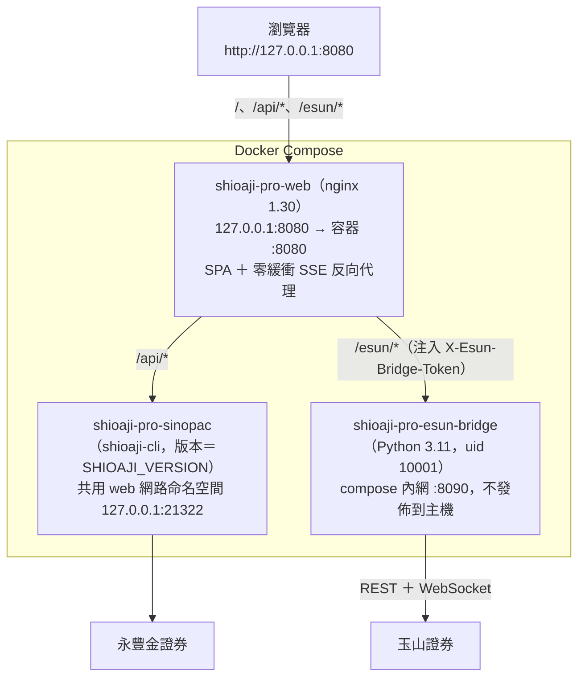

# 玉山整合與 Docker 部署（fork 專屬）

本文件是 fork（Shioaji Esun Pro）的玉山證券整合與 Docker 網頁版部署說明。上游 README 保持原樣，
fork 專屬內容都放在 `docs/fork/`。詞彙定義見 [context-esun.md](context-esun.md)，同步上游的流程見
[upstream-sync.md](upstream-sync.md)。

## 架構

預設採「永豐取行情 ＋ 玉山負責股票下單與帳務」雙券商並行，也可以在頂欄切換玉山或永豐帳號下單。



| 服務（容器名稱） | 映像 target | 說明 |
| --- | --- | --- |
| `shioaji-pro-web`（`shioaji-pro-web`） | `runner` | nginx 代管建置後的 SPA（`index.html`、`approval.html`），反向代理 `/api/` 與 `/esun/`。只接受允許的 Host，拒絕跨來源請求，加上防點擊劫持等安全標頭。 |
| `shioaji-server`（`shioaji-pro-sinopac`） | `shioaji` | 永豐 Shioaji API server。版本取自 repo 根目錄 `SHIOAJI_VERSION`（與上游 CI 同一來源）；讀取 `.env` 的 `SJ_API_KEY`／`SJ_SEC_KEY`，未設定時只待命並回報 unhealthy。 |
| `esun-bridge`（`shioaji-pro-esun-bridge`） | `esun-bridge` | 玉山證券橋接（`server/`）：委託、改價、減量、刪單、庫存、餘額、交割款、損益，以及 WebSocket 轉 `/esun/stream/orders` SSE。以非 root（uid 10001）執行，設定檔目錄唯讀掛載，登入熔斷狀態存於具名 volume `esun-state`（`/app/state`）。 |

## 前置準備

### 1. 憑證（`./certs/`）

```text
./certs/esun_cert.p12      # 玉山憑證
./certs/Sinopac.pfx        # （選填）永豐憑證，永豐下單才需要
```

設定檔的 `[Cert] Path = certs/esun_cert.p12` 以「設定檔所在目錄」為基準解析，所以既有的「設定檔在專案根目錄、
憑證在 `certs/`」佈局不需要搬檔。

### 2. 玉山設定檔

雙環境（推薦）：在專案根目錄放測試與正式兩個設定檔，頂欄可以切換；只提供其中一個時，另一個環境會顯示為不可選。

```powershell
# Windows PowerShell
Copy-Item esun-config.simulation.ini.example esun-config.simulation.ini   # 別名：esun-config.sim.ini
Copy-Item esun-config.production.ini.example esun-config.production.ini   # 別名：esun-config.prod.ini
```

```bash
# Linux / macOS / Git Bash
cp esun-config.simulation.ini.example esun-config.simulation.ini
cp esun-config.production.ini.example esun-config.production.ini
```

單一設定檔（向下相容）：複製 `esun-config.ini.example` 為 `esun-config.ini`，以 `[Core]` 判定環境：

```ini
[Core]
# 正式：Entry = https://esuntradingapi.esunsec.com.tw/api/v1（不可有 Environment 欄位）
# 測試：Entry = https://esuntradingapi-simulation.esunsec.com.tw/api/v1 且 Environment = SIMULATION
Entry = https://esuntradingapi.esunsec.com.tw/api/v1

[Cert]
Path = certs/esun_cert.p12

[Api]
Key = 您的玉山_API_KEY
Secret = 您的玉山_API_SECRET

[User]
# 11 碼（前 4 碼分公司代碼 + 7 碼帳號）或 7 碼帳號
Account = 8840xxxxxxx
```

橋接的監聽位址與埠號**不從設定檔讀取**，請用環境變數 `ESUN_SERVER_HOST`（預設 `127.0.0.1`）與 `ESUN_SERVER_PORT`（預設 `8090`）。

### 3. `.env`

複製 `.env.docker.example` 為 `.env`（一鍵部署腳本會自動複製），填入：

```dotenv
ESUN_ACCOUNT_PASSWORD=您的玉山證券登入密碼   # 輸錯 3 次會被玉山鎖帳（AGA0000）
ESUN_CERT_PASSWORD=您的玉山憑證密碼
SJ_API_KEY=您的永豐_API_KEY
SJ_SEC_KEY=您的永豐_SECRET_KEY
SJ_PRODUCTION=false                       # 永豐模擬模式即可取得完整即時行情
```

其他常用變數：

| 變數 | 預設 | 用途 |
| --- | --- | --- |
| `WEB_BIND` | `127.0.0.1` | web 在主機上綁定的位址。 |
| `WEB_PORT` | `8080` | web 在主機上的埠號。 |
| `WEB_SERVER_NAMES` | 空 | 額外允許的 Host（空白分隔），同時是 nginx `server_name` 與橋接 `ESUN_ALLOWED_HOSTS`。 |
| `WEB_BASIC_AUTH` | `off` | nginx Basic Auth 的 realm；`off` 表示停用。 |
| `ESUN_BRIDGE_TOKEN` | 空 | nginx 存取橋接的共享 token；部署腳本會自動產生（不顯示）。瀏覽器不持有 token。 |
| `ESUN_CONFIG_HOST_DIR` | `.` | 玉山設定檔所在的主機目錄，唯讀掛載到橋接的 `/app/host-config`。 |
| `ESUN_BRIDGE_UPSTREAM` | `http://esun-bridge:8090` | nginx 的橋接上游（結尾不要加 `/`）。 |
| `SHIOAJI_API_UPSTREAM` | `http://127.0.0.1:21322` | nginx 的永豐上游。 |

> `.env`、設定檔、`certs/`、`*.p12`、`*.pfx` 都列在 `.gitignore` 與 `.dockerignore`，不會被提交或進入建置 context。
> 密碼目前仍以環境變數傳入容器：具有 Docker 權限的本機使用者可以用 `docker inspect` 看到，請只在自己的電腦上執行。

## 啟動

一鍵部署腳本會檢查 Docker、初始化缺少的 `.env`／設定檔／`certs/`、產生 `ESUN_BRIDGE_TOKEN`，並建置與啟動所有容器；
任何 docker 指令失敗都會中止並回報，不會把舊容器的狀態誤報成新版已部署。

```powershell
pnpm run docker:deploy                 # 需要 PowerShell 7（pwsh）
.\scripts\deploy-docker.ps1 -Action up # Windows PowerShell 5.1 也可直接執行
```

```bash
./scripts/deploy-docker.sh up          # Linux / macOS / Git Bash
```

或直接使用 compose（不會自動產生 token；沒有 token 時橋接只在 compose 內網可達）：

```bash
docker compose up -d --build
```

開啟 <http://127.0.0.1:8080>。web 預設只綁 IPv4 的 127.0.0.1；Windows 會先以 IPv6（::1）解析 `localhost`，用 `localhost` 開啟時每條新連線都要等退回 IPv4 才成功（瀏覽器約 0.2–0.3 秒，部分程式約 2 秒），建議改用 127.0.0.1。

`package.json` 的 `docker:deploy`／`docker:down`／`docker:status` 呼叫 `pwsh`；Linux／macOS 請安裝 PowerShell 7，或改用
`./scripts/deploy-docker.sh`。

### Windows 宿主機橋接（`-HostBridge`，進階）

```powershell
.\scripts\deploy-docker.ps1 -Action up -HostBridge
```

腳本會以 `deploy/install_sdk.py` 安裝並驗證 Windows wheel，在宿主機背景啟動 `server/esun_trade_server.py`
（預設只綁 `127.0.0.1:8090`，日誌在 `esun-bridge.log`／`esun-bridge.err.log`），再以 `--no-deps` 啟動 web 與永豐容器，
nginx 透過 `host.docker.internal` 代理到宿主機。若容器連不到宿主機的 127.0.0.1，可設定 `ESUN_HOST_BRIDGE_BIND=0.0.0.0`
（橋接仍要求 `ESUN_BRIDGE_TOKEN`）。

- 宿主機橋接的 `ESUN_BRIDGE_TOKEN`、密碼與 `ESUN_ALLOWED_HOSTS` 每次都從 `.env` 重新讀取（同名鍵重複時與 compose 相同，
  以最後一行為準），只在啟動子程序的當下帶入；腳本結束時會把它改動過的 PowerShell 環境變數還原，同一個視窗重跑或改用
  全容器模式不會沿用殘留值。執行腳本前自行在 shell 設定的變數優先且會保留。
- `ESUN_ALLOWED_HOSTS` 未設定時，以 `WEB_SERVER_NAMES`（shell > `.env` > 空）帶入，與容器模式的 compose 對應一致；
  依[區網存取](#區網存取)設定 `WEB_SERVER_NAMES` 後，宿主機橋接也會接受這些 Host（否則 `/esun/` 會回 421）。
- **Linux Docker Engine**（非 Docker Desktop）自行在宿主機執行橋接時（模式 B；`-HostBridge` 只支援 Windows）：nginx 以 resolver 在執行期解析
  `ESUN_BRIDGE_UPSTREAM`，不讀 `/etc/hosts`，compose `extra_hosts` 寫入的 `host.docker.internal` 會解析失敗（`/esun/` 回 502）。
  請把 `.env` 的 `ESUN_BRIDGE_UPSTREAM` 設為 gateway IP，例如 `http://172.17.0.1:8090`。Docker Desktop（Windows／macOS）不受影響。

## 安全模型

- **只綁本機**：web 預設發佈到 `127.0.0.1`；`esun-bridge` 只 `expose` 在 compose 內網，不發佈到主機。
- **Host 允許清單**：nginx 只服務 `localhost`、`127.0.0.1` 與 `WEB_SERVER_NAMES`，其他 Host（例如 DNS rebinding、以區網 IP 直連）
  由預設 server 直接斷線（444）。橋接另有自己的 Host 白名單（`ESUN_ALLOWED_HOSTS`）。
- **跨來源防護**：`/api/` 與 `/esun/` 拒絕 Origin 與 Host 不符、`Origin: null`、`Sec-Fetch-Site: cross-site/same-site` 的請求（403）。
- **橋接 token**：nginx 在 `/esun/` 注入 `X-Esun-Bridge-Token` 並覆寫客戶端自帶的同名標頭；橋接以常數時間比對。
  也就是說，nginx 本身就是信任邊界——能連到 nginx 的人就能操作交易端點。
- **安全標頭**：`X-Frame-Options: DENY`、`Content-Security-Policy: frame-ancestors 'none'`、`X-Content-Type-Options: nosniff`、
  `Referrer-Policy: same-origin`；`index.html`／`approval.html` 不快取，只有帶雜湊的資產長期快取。
- **最小權限**：橋接以 uid 10001 執行、`cap_drop: ALL`、`no-new-privileges`，設定檔目錄唯讀掛載。
- **SDK 完整性**：`deploy/install_sdk.py` 以 `deploy/esun_trade.sha256` 驗證 wheel，雜湊不符或沒有相容平台的 wheel 時建置失敗。
  repo 只附 Linux x86_64 與 Windows x64 wheel；ARM 主機（例如 Apple Silicon）需要另外取得對應 wheel。

## 區網存取

**不要把 8080／8090 直接暴露到區網。** 真的需要讓其他裝置連線時：

1. 產生 htpasswd（任一方式）：
   ```bash
   docker run --rm httpd:2.4-alpine htpasswd -nbB trader '強密碼' > ./secrets/htpasswd
   ```
2. 在 `.env` 設定：
   ```dotenv
   WEB_BIND=0.0.0.0              # 或指定網卡 IP
   WEB_SERVER_NAMES=192.168.1.20 trade.lan
   WEB_BASIC_AUTH=ShioajiPro
   ```
3. 以 `docker-compose.override.yml` 唯讀掛載 htpasswd：
   ```yaml
   services:
     shioaji-pro-web:
       volumes:
         - ./secrets/htpasswd:/etc/nginx/auth/htpasswd:ro
   ```
4. `docker compose up -d`。Basic Auth 走明文 HTTP，跨出可信任網段時請在前面加 TLS 反向代理。

容器 healthcheck 使用免驗證的 `/healthz`，啟用 Basic Auth 不影響健康狀態。

## 非 root 與檔案權限

橋接以 uid 10001 執行。Docker Desktop（Windows／macOS）的綁定掛載對容器內所有使用者可讀，不需調整；
Linux 主機請確認設定檔與 `certs/esun_cert.p12` 對其他使用者可讀（例如 `chmod o+r`），或在 override 檔中以 `user:` 指定
與檔案擁有者相同的 uid（此時 `esun-state` volume 的擁有者也要一致）。永豐 sidecar（上游 CLI）目前仍以 root 執行。

## 玉山 API 官方限制與橋接防護

| 項目／代碼 | 官方限制 | 橋接防護 |
| --- | --- | --- |
| 登入鎖帳（`AGA0000`） | 連續密碼錯誤 3 次鎖帳 | 單次熔斷：登入失敗後鎖定（`loginLocked`），不自動重試；熔斷狀態寫入 `ESUN_STATE_DIR`（Docker 為具名 volume），容器重啟後不會再自動登入，須修正後手動重連 |
| 登入頻率（`AGR0000`） | 每分鐘 10 次 | 滑動視窗限流；觸發後冷卻 60 秒 |
| 每日登入（`AGR0004`） | 每日 300 次 | 每日累計計數 |
| 登入 token 換日失效 | 台北換日後舊登入失效（WebSocket 1011 `Token Validation Error`、SDK `A0000x: response parse Error`） | 判定依「登入開始時間」（`client.login()` 前記錄）：早於「今日 00:00 ＋ `ESUN_AUTO_RELOGIN_NOT_BEFORE`（預設 00:05）」的 session 視為換日前 session（含 23:59:59 開始、午夜後才完成，以及 00:00–00:05 間完成的登入）。換日前 session 收到 WebSocket token 錯誤或 SDK 回應解析失敗時判定失效；之後才登入的 session 收到 token 錯誤屬「日間失效」（可能在其他地方重新登入），**不自動重新登入**，health 要求手動重連，以免踢掉其他工具的登入。失效後 health 改回 `loggedIn: false`、`sessionExpired: true`；委託在呼叫 SDK 前即以 503 `ESUN_SESSION_EXPIRED`（`not_sent`）拒絕，查詢回 503；舊 WebSocket 停止重連；已在 SDK 呼叫中的委託維持 `accepted`／`unknown`。換日型失效自動重新登入（`ESUN_AUTO_RELOGIN=0` 可停用）：第一次在 max(偵測＋2 秒, 今日 00:05) ＋ 0–60 秒隨機延遲（`ESUN_AUTO_RELOGIN_JITTER_SECONDS`）；只有明確未送出的網路失敗（DNS、connection refused、unreachable）與 AGR0000（至少等完冷卻）依 2／5／10 分鐘重試（`ESUN_AUTO_RELOGIN_RETRY_MINUTES`）；可能已送達伺服器的失敗（timeout、EOF、502／503／504）同一次失效最多 2 次嘗試。只有明確的憑證錯誤（AGA0000、密碼、憑證）才啟動持久熔斷；無法辨識的回應（含 `A0000x: response parse Error`、SDK 核心 panic）改為 `autoRelogin.state: paused`，不寫熔斷與指紋，按「重新連線」即可手動登入。手動登入路徑的分類維持 fail-safe（無法辨識一律視為憑證錯誤）。每次嘗試記錄時間與結果 |
| 委託頻率（`AGR0002`） | 每秒 20 筆 | 限制 18 筆／秒 |
| 每日委託（`AGR0001`） | 每日 2,000 筆 | 新單、改價、改量、刪單合計計數 |
| 委託數量 | 整股 499 張／零股 999 股 | 前端與橋接都先檢查 |
| 預約單（`AG0006`） | 預約單不可改價改量 | 直接拒絕，只允許刪單後重下 |
| 改價條件 | 僅限價 ROD 可改價 | 市價、IOC、FOK 禁止改價 |
| 銀行餘額 | 避免高頻查詢 | 180 秒快取 |
| 交割款（`AGR0006`） | 每分鐘 3 次 | 25 秒快取 ＋ 3 次／分限流 |
| 庫存（`AGR0003`） | 每分鐘 10 次 | 6 秒快取，收到成交（MAT）即失效 |
| 已實現損益（`AW00002`／`AW00003`） | 區間不超過 180 天 | 自動鉗位在 180 天內 |

改量的語意固定為「**減少量**」（與上游 `updateOrderQty` 及 SDK `cancel_order(cel_qty=…)` 一致），委託 mutation 的請求／回應
信封與結果未知的處理方式見 [context-esun.md](context-esun.md)。

## 常用管理與排錯指令

```bash
pnpm run docker:status                    # 或 docker compose ps
curl http://127.0.0.1:8080/esun/health    # 玉山登入狀態、環境、待配置項目
curl http://127.0.0.1:8080/api/v1/info    # 永豐 sidecar 狀態
docker compose exec esun-bridge curl -s localhost:8090/esun/livez   # 直接檢查橋接存活（不經 nginx）
docker compose up -d                      # 修改 .env 後重新載入
docker compose logs -f esun-bridge        # 或 shioaji-server、shioaji-pro-web
pnpm run docker:down                      # 或 docker compose down
```

修正玉山密碼或設定檔後，手動解除熔斷並重新登入：

```bash
curl -X POST -H 'Content-Type: application/json' -d '{}' http://127.0.0.1:8080/esun/auth/reconnect
```

```powershell
Invoke-RestMethod -Method Post -ContentType 'application/json' -Body '{}' http://127.0.0.1:8080/esun/auth/reconnect
```

## 開發模式（Vite）

`pnpm dev` 會把 `/esun` 代理到 `VITE_ESUN_BRIDGE_TARGET`（預設 `http://127.0.0.1:8090`）；`.env` 或環境變數有
`ESUN_BRIDGE_TOKEN` 時由 dev proxy 注入標頭。橋接需另外以 `pnpm run esun-bridge`（或 `python server/esun_trade_server.py`）啟動；
橋接離線時 `/esun` 請求會直接失敗，由前端顯示離線狀態。
